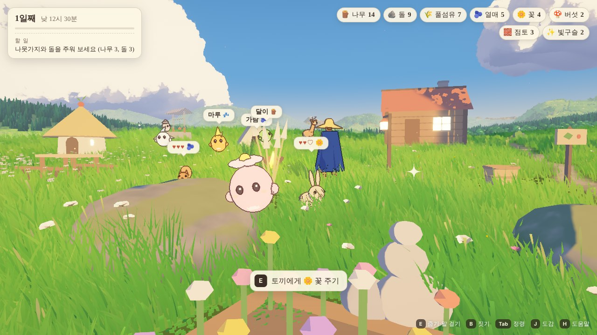

# 정령의 골짜기 (Spirit Valley)

손으로 그린 애니메이션 배경 같은 여름 골짜기에서 재료를 모으고, 정령과 동물을 만나 친구가 되고, 내 땅에 캠핑장과 집을 짓는 느긋한 생활 게임입니다. three.js(WebGL2)로 브라우저에서 돌아갑니다.

오픈소스 데모 **[Painted valley](https://patch.gg/blendi/painted-valley)** (Patch, 코드 MIT · 아트 CC0 1.0)를 바탕으로 만들었습니다. 골짜기·하늘·풀밭·나그네는 그 데모의 것이고, 게임(채집·정령·동물·건축·하루의 흐름·화면)은 `src/game/`에 새로 썼습니다.



## 무엇을 하나요

- **돌아다니며 모으기** — 나무 아래 나뭇가지, 바위 곁 돌무더기, 열매 덤불, 그늘의 버섯, 풀밭의 들꽃과 억새, 물가의 갈대와 점토. 반짝이는 것에 다가가 `E`. 나무는 흔들고 바위는 캘 수 있습니다. 가져간 것은 시간이 지나거나 다음 날이면 다시 생깁니다.
- **정령과 친구 되기** — 숲·바위 곁·꽃밭·언덕·물가에 사는 정령이 저마다 바라는 선물이 있습니다(머리 위 말풍선). 선물을 주면 내 땅까지 따라옵니다. 불씨정령은 내 모닥불에 찾아옵니다.
- **정령에게 일 맡기기** — `Tab`에서 나무하기·돌 캐기·풀 베기·먹거리 찾기·점토 캐기·건설 돕기 중 하나를 맡기면 다녀와서 내 땅의 바구니에 재료를 담아 둡니다. 정령마다 두 배로 잘하는 일이 있습니다. 정령집을 지으면 더 많은 정령이 머뭅니다.
- **내 땅에 짓기** — 언덕 위 말뚝으로 둘러싸인 곳이 내 땅입니다. `B`로 모닥불·텐트·통나무 의자·식탁·등불·울타리·디딤돌·정령집·꽃밭·열매밭·먹이터·우물·오두막·빛의 돌탑을 놓고, 가까이서 `E`를 누르고 있거나 정령에게 맡겨 완성합니다. 철거하면 재료를 모두 돌려받습니다.
- **동물 만나기** — 다람쥐·토끼·사슴·여우·오리. 달려가면 달아나고, `Alt`로 살금살금 다가가면 좋아하는 것을 받아먹습니다. 하루에 한 번, 세 번 먹이면 단짝이 되어 먹이터에 놀러 옵니다.
- **하루** — 낮 12시 반에 시작해 약 13분 뒤 해가 집니다. 텐트에서 쉬면 다음 날 아침. 저녁에는 등불과 창문에 불이 켜지고 모닥불이 풀밭을 밝힙니다.
- **저장** — 브라우저(localStorage)에 자동 저장됩니다. 도움말(`H`)에서 처음부터 다시 시작할 수 있습니다.

## 조작

| | |
|---|---|
| `W A S D` | 걷기 · `Shift` 달리기 · `Alt` 살금살금 · `Space` 점프 |
| 마우스 | 둘러보기 · 휠로 멀리/가까이 · `V` 1인칭 |
| `E` | 줍기 · 흔들기 · 선물하기 · 먹이 주기 · 짓기(누르고 있기) · 놓기 |
| `B` | 짓기 메뉴 — 고른 뒤 `R` 돌리기, 클릭/`E` 놓기, `X` 취소 |
| `Tab` | 정령 친구들 (일 맡기기) |
| `J` / `H` | 도감과 할 일 / 도움말 |
| `P` | 붓질 마감 켜고 끄기 |

키보드와 마우스가 있는 데스크톱 브라우저용입니다(터치 조작은 아직 없습니다).

## 실행

```sh
npm install
npm run dev      # http://127.0.0.1:5384
# 또는
npm run build    # dist/ 에 빌드
npm run serve    # http://127.0.0.1:5383
```

주소 뒤에 붙일 수 있는 것: `?quality=low` 또는 `medium`(가벼운 그리기), `?new`(저장을 건드리지 않고 새 게임), `?debug`(`T`, `1`–`4`, `,` `.`로 시간 바꾸기).

## 어디에 무엇이 있나요

| | |
|---|---|
| `src/game/data.js` | 재료, 건물(비용·공사 시간), 정령, 동물, 할 일 — 숫자와 글 |
| `src/game/game.js` | 규칙과 하루: `E`가 하는 일, 놓기와 철거, 잠, 목표, 저장 |
| `src/game/nodes.js` | 골짜기에 놓인 채집물과 반짝임 |
| `src/game/spirits.js` | 정령: 야생 정령이 사는 곳, 친구가 된 정령의 일 |
| `src/game/animals.js` | 동물의 움직임과 친밀도 |
| `src/game/build.js` | 건물: 공사, 충돌, 풀 깎기, 미리보기 |
| `src/game/models.js`, `paint.js` | 모든 모양(도형으로 조립)과 칠(배경은 물감, 생물은 셀 + 잉크 선) |
| `src/game/ui.js`, `ui.css` | 화면: 가방, 말풍선, 짓기·정령·도감 패널 |
| `src/valley/`, `src/lib/`, `src/figure/` | Painted valley: 땅·하늘·풀밭·나그네 ([원래 설명](docs/painted-valley.md)) |

새 건물을 더하려면 `data.js`의 `BUILDINGS`에 한 줄, `models.js`의 `build`에 모양 하나를 더하면 됩니다. 정령과 동물도 같은 식입니다.

## 소리

발소리(CC0)와 코드로 만든 짧은 효과음만 들어 있습니다. 원본 데모의 바람·새·물소리 다섯 개는 재배포할 수 없는 녹음이라 저장소에 없습니다. 넣는 방법은 [MISSING_ASSETS.md](MISSING_ASSETS.md)에 있습니다.

## 라이선스와 출처

코드 MIT, 아트 CC0 1.0. 바탕이 된 Painted valley는 Patch의 작품이며(MIT/CC0), 물리는 Rapier(Apache-2.0), 나그네는 MakeHuman 인물(CC0)과 Quaternius의 애니메이션(CC0), 길의 흙은 ambientCG(CC0), 발소리는 Kenney(CC0)입니다. 부분별 출처는 [LICENCE-NOTES.md](LICENCE-NOTES.md)에 있습니다. 이 게임의 건물·정령·동물·글은 모두 이 저장소에서 새로 만든 것입니다.
