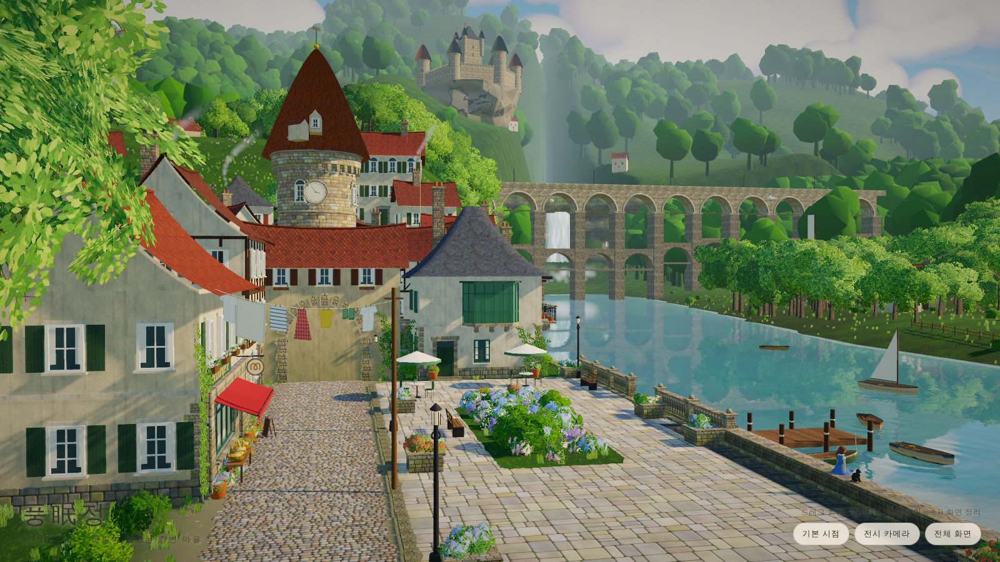

# 풍眠정 · Windvale

바람이 잠드는 강변 마을. 브라우저에서 바로 돌아가는 Three.js 3D 장면입니다.
모델 파일이나 이미지 파일은 하나도 쓰지 않습니다. 건물, 나무, 꽃, 물, 하늘, 인물과 고양이, 모든 텍스처를 코드로 만듭니다.

## 여는 법

`index.html` 하나로 완결된 페이지입니다. 파일을 더블클릭해 브라우저로 열면 됩니다.
Three.js(0.170.0)만 jsDelivr CDN에서 불러오므로 처음 열 때 인터넷 연결이 필요합니다.
`npm run build`를 하면 `dist/windvale/`에도 그대로 복사되어 GitHub Pages에서 `/windvale/`로 열립니다.

| 조작 | |
|---|---|
| 마우스 드래그 | 시점 회전 |
| 휠 | 확대 · 축소 |
| 우클릭 드래그 | 평행 이동 |
| **기본 시점** 버튼 / `R` | 표지 구도로 천천히 돌아오기 |
| **전시 카메라** 버튼 / `C` | 아주 느리게 둘러보는 카메라 (화면을 누르면 멈춤) |
| **전체 화면** 버튼 / `F` | 전체 화면 |
| `H` | 글자와 버튼 숨기기 |

## 장면

- **왼쪽 생활 거리**: 빨간 천 차양과 쇼윈도(안에 빵 선반), 나무 간판·걸이 간판, 빵 바구니 벤치, 칠판 입간판, 화분이 있는 빵집. 경사를 따라 휘는 돌길, 문 앞 돌계단, 덩굴과 창턱 화분, 앞을 감싸는 큰 나무.
- **가운데**: 휘어진 원뿔 지붕(비늘 기와), 시계, 아치 창, 지붕창, 풍향계가 있는 돌탑. 녹색 유리 돌출창과 강 쪽 발코니가 있는 집. 거리 위를 가로지르는 아치 문루. 한 채씩 다르게 만든 집들(반목조, 돌출 2층, 모임지붕, 맞배지붕, 코너석). 거리를 건너는 빨랫줄.
- **오른쪽 강변**: 판석 테라스, 난간, 화분과 수국 화단, 벤치와 카페 테이블, 낮은 돌턱에 앉은 소녀와 검은 고양이, 부두로 내려가는 돌계단, 나룻배 세 척과 돛단배.
- **원경**: 숲이 군락을 이루는 언덕, 산꼭대기 성, 계곡을 건너는 2단 석조 철도 다리, 절벽 폭포(물줄기, 물보라, 거품), 풍차, 멀리 있는 농가, 구름과 새.

## 움직임

모든 움직임은 주기와 위상을 서로 다르게 잡아 기계적으로 맞물리지 않게 했습니다.

- 강물: 직접 작성한 GLSL 셰이더. 흐름 방향으로 움직이는 여러 크기의 잔물결, 평면 반사, 햇빛 반짝임, 강가 물결, 배 주변 동심원 물결.
- 소녀: 땋은 머리와 리본, 치맛자락만 바람에 아주 살짝 흔들립니다.
- 고양이: 꼬리가 느리게 흔들리다 가끔 끝을 튕기고, 이따금 고개를 들어 소녀 쪽을 봅니다.
- 나비가 화단 주변을 날고, 갈매기가 강 위를 돌며 날갯짓과 활공을 번갈아 합니다.
- 나뭇잎, 풀, 꽃, 덩굴이 바람에 흔들리고(그림자도 함께), 빨래가 펄럭이며, 굴뚝 연기가 천천히 오르고, 배가 출렁이고, 풍차가 돌고, 성의 깃발이 날리고, 구름이 흘러갑니다.

## 기술 메모

- 텍스처: 회벽, 마름돌, 기와, 비늘 기와, 길 따라 깔린 포석, 판석, 나무판, 나무껍질, 풀밭, 잎 뭉치, 꽃 아틀라스, 구름, 간판을 모두 캔버스에서 그립니다. 높이맵에서 노멀맵도 만듭니다.
- 지붕: 처마로 갈수록 휘는 곡면 판(두께와 용마루 처짐 포함). 탑 지붕은 아래가 퍼지는 회전체입니다.
- 나무와 덤불: 잎 카드를 뭉치로 모으고 구형 노멀을 주어 그림처럼 덩어리져 보이게 했고, 역광이 비치면 잎이 밝아집니다.
- 성능: 정적 지오메트리를 재질별로 하나로 합쳐 드로우 콜을 줄였습니다(약 150개). 숲, 덤불, 꽃, 풀은 인스턴싱합니다. 숲은 가까운 띠(잎 카드 나무)와 먼 띠(단순한 덩어리 나무) 두 단계 LOD로 나눴습니다. 그림자 맵은 4096 한 장을 두 프레임에 한 번 갱신하고, 반사는 절반 해상도로 그리며 작은 소품(꽃·풀)은 반사에서 뺐습니다. 픽셀 비율은 최대 1.5입니다.
- 후처리: 부드러운 필르믹 톤매핑, 그림자는 차갑게 하이라이트는 따뜻하게 하는 약한 색 보정, 비네팅과 아주 옅은 종이 질감. 블룸은 쓰지 않았습니다.
